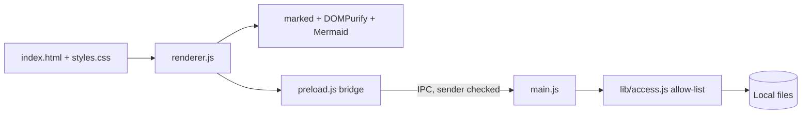

# Writer architecture

Writer is a local-first Windows writing workspace, split into small layers with one rule: **the
page asks, the main process decides.**

## Core principles

- **Local-first:** documents stay on disk; there is no account, sync service, or remote API.
- **Thin bridge:** the page can only call the operations exposed in `preload.js`.
- **Main process is the authority:** file access is decided in `main.js` using `lib/access.js`, never
  by trusting the page.
- **Replaceable rendering:** Markdown and Mermaid are renderer adapters; file I/O does not change if
  they do.
- **Small surface:** tabs, workspaces, search, themes and export are composed from simple commands.

## Modules

| File            | Responsibility                                                                     |
| --------------- | ---------------------------------------------------------------------------------- |
| `main.js`       | Windows, dialogs, folder watching, export, and every IPC handler                   |
| `preload.js`    | `contextBridge` API (`window.writer`); resolves dropped file paths                 |
| `renderer.js`   | Workspace state, tabs, editor, preview, command palette, settings                  |
| `lib/paths.js`  | Path containment (symlink-aware), note-name sanitizing, HTML escaping, export page |
| `lib/access.js` | `AccessList`: granted folders and individually opened files                        |

`lib/` has no Electron dependency, so it is unit-tested with plain Node (`npm test`).

## Security model

1. The user grants access through the folder picker, the open-files dialog, or a real drop. Granted
   folders persist in `userData/workspaces.json`.
2. Each IPC handler is wrapped by `handle()`, which rejects calls whose sender frame is not
   Writer's own `index.html`.
3. Handlers then check arguments against the `AccessList`. Paths are canonicalised with
   `realpath`, so symlinks and `..` cannot escape a granted folder. Only document extensions pass.
4. The preview sanitises Markdown output with DOMPurify before it reaches `innerHTML`; Mermaid
   runs in `strict` mode. The CSP blocks inline scripts, remote origins and plugins.
5. Windows are sandboxed, cannot navigate or open child windows, and permission requests are
   denied.

See [SECURITY.md](SECURITY.md) for reporting and known limitations.

## Runtime flow

1. `main.js` loads the allow-list, registers IPC handlers, and creates a sandboxed `BrowserWindow`.
2. `preload.js` exposes the minimal `writer` API.
3. `renderer.js` owns UI state and calls `writer.*` for anything touching disk.
4. Saves are atomic (temp file, then rename). Folder watchers are tracked per window.

## Failure behavior

- A refused or failed IPC call rejects the promise; saving shows **Save failed** and keeps the
  buffer in the editor.
- A missing or corrupt `workspaces.json` starts with no granted folders; nothing else breaks.
- A Mermaid error renders an inline message instead of breaking the preview.

## Why Electron

Electron gives dependable Windows text input, native dialogs, filesystem access and a mature
packaging path. The UI is local and offline; it never loads a website or sends document content to
a server.

## Future adapters

The layout leaves room for a native rendering adapter, an opt-in sync adapter, and richer
third-party commands without changing the document model.
