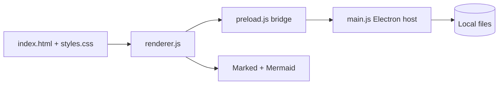

# Writer architecture

Writer is a local-first Windows writing workspace. It is intentionally split into four small layers:

## Core principles

- **Local-first:** documents stay on disk; there is no account, sync service, or remote document API.
- **Thin bridge:** renderer code can access only the explicitly exposed file and window operations.
- **Replaceable rendering:** Markdown and Mermaid are renderer adapters; a future renderer can be added without changing file I/O.
- **Small product surface:** tabs, workspaces, search, themes, and export are composed from simple commands.
- **Honest support matrix:** features are documented as working, experimental, or planned.

## Runtime flow

1. Electron creates a sandboxed `BrowserWindow`.
2. `preload.js` exposes the minimal `writer` API through `contextBridge`.
3. `renderer.js` owns workspace state, tabs, editing, preview, commands, and settings.
4. `main.js` performs filesystem access, native dialogs, folder watching, HTML export, and new-window creation.

## Why Electron for this release

Electron gives Writer dependable Windows text input, native dialogs, filesystem access, and a mature packaging path. The UI is local and offline; it does not load a website or send document content to a server.

## Future adapters

The architecture leaves room for a native rendering adapter, a sync adapter, and third-party commands without requiring a rewrite of the document model.
