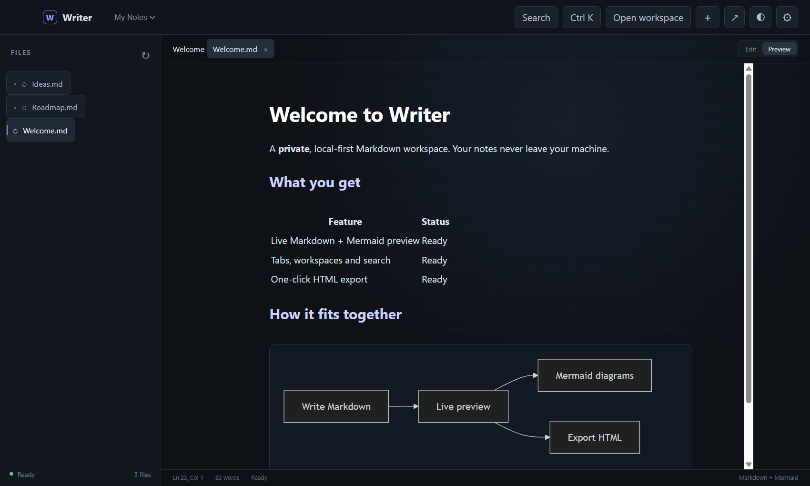
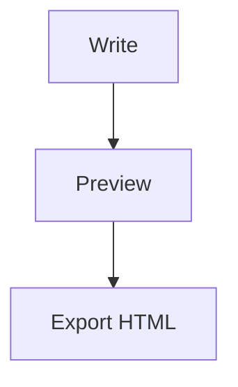

<div align="center">
  

# Writer for Windows

**A fast, private Markdown workspace. Local-first, with Mermaid diagrams, tabs, workspaces, search and HTML export.**

[](https://github.com/boss477/writer-windows/actions/workflows/ci.yml)
[](https://github.com/boss477/writer-windows/releases)
[](https://github.com/boss477/writer-windows/releases)
[](LICENSE)




</div>

Writer keeps your notes as plain files in folders you choose. There is no account, no sync service
and no telemetry: documents never leave your machine.

## Contents

1. [Features](#features)
2. [Install](#install)
3. [Quick start](#quick-start)
4. [Keyboard shortcuts](#keyboard-shortcuts)
5. [Security and privacy](#security-and-privacy)
6. [Development](#development)
7. [Project layout](#project-layout)
8. [Documentation](#documentation)
9. [Contributing](#contributing)
10. [License](#license)

## Features

- GitHub-flavored Markdown with a sanitized live preview
- Mermaid flowcharts, sequence diagrams, state diagrams and more
- Multiple document tabs and multiple windows
- Several remembered workspace folders you can switch between
- Full-text search across the workspace
- File watching: changes made outside Writer show up in the file list
- Drag and drop Markdown, text and HTML files
- Auto-save with a visible save state, plus cursor and word counters
- Dark and light themes, adjustable editor font and preview width
- Command palette (`Ctrl+K`) and declarative [workspace commands](docs/EXTENSIONS.md)
- One-click standalone HTML export
- Per-user Windows installer, no admin rights needed

## Install

1. Download `Writer-<version>-Windows-x64.exe` from the
   [latest release](https://github.com/boss477/writer-windows/releases/latest).
2. Run it and follow the installer.

**About the SmartScreen warning.** The installer is not code-signed, so Windows SmartScreen may show
"Windows protected your PC". Choose **More info → Run anyway**. Every release publishes a
`SHA256SUMS.txt`; you can check your download in PowerShell:

```powershell
(Get-FileHash .\Writer-0.1.0-Windows-x64.exe -Algorithm SHA256).Hash
```

## Quick start

1. Click **Open workspace** and pick a folder of notes (an empty folder is fine).
2. Click **＋** to create a note, then write Markdown.
3. Switch to **Preview** to see rendered Markdown and Mermaid diagrams.
4. Open the command palette with `Ctrl+K` to export HTML, change themes or open a new window.

Try the bundled [Mermaid example](examples/mermaid.md).

````markdown

````

## Keyboard shortcuts

| Shortcut | Action               |
| -------- | -------------------- |
| `Ctrl+K` | Command palette      |
| `Ctrl+O` | Open files           |
| `Ctrl+S` | Save                 |
| `Ctrl+F` | Search the workspace |

## Security and privacy

Writer is built to stay safe even when you open a document you do not trust:

- **Sandboxed renderer** with context isolation, a strict Content Security Policy, no Node.js
  integration, and navigation and pop-ups blocked.
- **Sanitized preview.** Rendered Markdown is passed through DOMPurify, so raw HTML in a note cannot
  run script.
- **Scoped file access.** The app can only read and write documents inside folders you picked, or
  files you opened or dropped. Anything else is refused in the main process.
- **Safe saves.** Documents are written atomically, and new notes never overwrite existing ones.
- **Offline.** No network requests, no analytics.

See [SECURITY.md](SECURITY.md) for the threat model and how to report a vulnerability.

## Development

Requires Node.js 20 or newer and Windows 10 or 11.

```powershell
git clone https://github.com/boss477/writer-windows.git
cd writer-windows
npm ci
npm start
```

| Command            | What it does                                             |
| ------------------ | -------------------------------------------------------- |
| `npm start`        | Run the app from source                                  |
| `npm run lint`     | ESLint                                                   |
| `npm run format`   | Prettier (use `format:check` to verify only)             |
| `npm test`         | Unit tests (path safety, access control, export)         |
| `npm run test:e2e` | Launch the real app and test the preview and file bridge |
| `npm run check`    | Lint, format check and unit tests (what CI runs first)   |
| `npm run dist`     | Build the NSIS installer into `dist/`                    |

### Releasing

Update `version` in `package.json` and [CHANGELOG.md](CHANGELOG.md), then tag:

```powershell
git tag v0.2.0
git push --tags
```

The [release workflow](.github/workflows/release.yml) runs the full CI suite, builds the installer
and publishes a GitHub Release with checksums.

## Project layout

```text
main.js        Electron main process: windows, dialogs, scoped file IPC
preload.js     The narrow window.writer bridge exposed to the page
renderer.js    UI state: workspaces, tabs, editor, preview, commands
lib/           Pure, unit-tested helpers (path safety, access list, export)
test/          Unit tests; test/e2e drives the real app
docs/          Extension notes and images
examples/      Sample note and workspace command
```

## Documentation

- [Architecture and security model](ARCHITECTURE.md)
- [Workspace commands (extensions)](docs/EXTENSIONS.md)
- [Changelog](CHANGELOG.md)

## Contributing

Bug reports, ideas and pull requests are welcome. Read [CONTRIBUTING.md](CONTRIBUTING.md) first and
follow the [Code of Conduct](CODE_OF_CONDUCT.md).

## License

[MIT](LICENSE) © boss477
