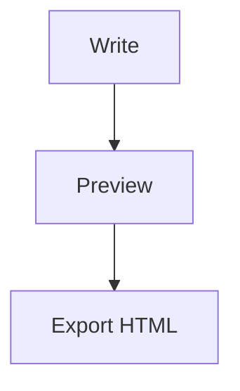

# Writer for Windows

A fast, private Markdown workspace for Windows with Mermaid diagrams, live preview, tabs, workspaces, search, themes, file watching, drag-and-drop, command palette, and HTML export.

Writer is a local-first desktop product, not a hosted editor. Documents remain on your machine and the app is built around a small Electron host, a narrow preload bridge, and a replaceable Markdown/Mermaid renderer. See [ARCHITECTURE.md](ARCHITECTURE.md) and [extension notes](docs/EXTENSIONS.md).

## Features

- GitHub-flavored Markdown and HTML preview
- Mermaid flowcharts, sequence diagrams, state diagrams, and more
- Multiple document tabs and Writer windows
- Multiple remembered workspace folders with switching
- Full-text workspace search
- File watching with open-document refresh
- Drag-and-drop Markdown, text, and HTML files
- Auto-save, save status, and cursor/word counters
- Dark/light themes and editor settings
- Command palette (`Ctrl+K`)
- HTML export
- Windows NSIS installer

## Run locally

```powershell
npm install
npm start
```

Run the source checks:

```powershell
npm run check
```

## Build the Windows installer

```powershell
npm run dist
```

The installer is generated in `dist/`.

## Mermaid example

````markdown

````

## License

MIT
